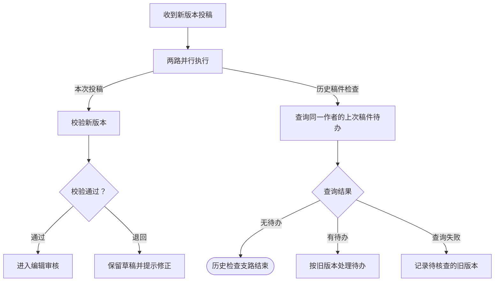

# 可读性正反例与读图验收

用于主线、分支、局部结束、回查与父子衔接的绘制和评审。先按 [流程建模规范](modeling-standard.md) 确定真实关系，再用这里的画法检查读者是否能沿线读懂。无需为单纯文字修订重新验收所有流程。

## 阅读路径

- 让正常路线沿主轴连续推进，把判断条件放在对应出线附近。
- 在同一判断附近呈现成功、失败和待核查的出口。
- 回查线走外围，并标出返回位置。
- 以职责划分区域，让读者能从阶段入口追到本阶段结果。

以下用虚构的知识库投稿场景说明画法。

## 例一：历史稿件检查结束，本次投稿仍继续

示例假定作者重新投稿时，一路校验新版本并进入审核，另一路检查旧版本是否还有待办。两路各自继续。

**反例。** 提交动作分出两条线，旧稿不存在就连到「结束」，新稿接到「审核中」后也没有后续。读者无法判断两路是否并行、谁还在继续，以及结束影响哪个版本。

**正例。** 给并行分流注明两路职责，将本次投稿放在主轴，历史稿件检查放在相邻区域。



先在同一局部视图确认读者能辨认两路和局部结束。图幅过长时，用成对的跨图输出与接收表示后续。保留两路各自的对象和失败结果。如果真实实现用消息启动历史检查，补出消息发送和接收，并保留原稿件关联。

## 例二：发布结果集中，回查有明确来源

**反例。** 任务受理后立即标记发布成功。没有收到结果时，沿“稍后重试”直接创建新的发布任务。

**正例。** 在同一个判断附近放置已发布、明确失败和结果未知三个出口。结果未知时保留原发布任务 ID，之后按已确定的触发条件查询这条任务。

| 画布位置 | 表达内容 |
| --- | --- |
| 主轴 | 登记发布任务，核对原任务结果。确认发布成功后展示可见文章 |
| 结果区 | 明确失败进入修正，未知进入待查询，并说明本轮检查结束的范围 |
| 独立入口 | 按证据表达真实触发，例如待查询任务到期或收到关联的发布结果 |
| 外围回查线 | 从真实触发入口回到原任务的结果核验，保留稿件、版本和任务关联 |

超期、查询失败或待查询状态保存失败按实际策略展开。复核时沿原任务走到结果，确认恢复入口不会把结果未知当成重新发布的依据。

## 绘图示例：从一个业务输入展开异步支路

这是初稿的绘制顺序，适用于已经确认主线不等待后台结果的场景：

1. 先画父图传入的业务对象及同一次分流；子图复用其含义，不额外启动一遍。
2. 画主线真实后续，再在旁边画“发送后台提示”。
3. 紧接着画对应的“收到该提示”，以明确的异步交付关系连接，写明必要的对象关联。发送成功只代表发出；实际到达才触发接收后的处理。
4. 为发送的失败/未知补已有或已确认的恢复出口，保持主线独立继续。独立补扫从自己的定时入口触发，不从发送失败的结束点拉顺序线。
5. 同时补齐子图输出与父图接收位置。同步返回接原调用结果处理；异步结果接原任务的接收点，均不重新发起业务。

```text
父图业务输入 → 同一次分流
                ├─ 主线校验与启动 → 父图主线后续
                └─ 发送后台提示 → 投递结果
                                   ├─ 成功：异步交付 → 收到该提示 → 后台处理
                                   └─ 失败/未知 → 保留恢复责任 → 本次发送退出

独立定时补扫 → 查询原记录 → 后台核验（仅当方案或源码支持）
```

失败保存机制及消息延迟/丢失的恢复按项目证据绘制，示意图不证明这些能力已实现。只有发送关系存在时才能使用派生接收；真实独立外部事件继续保留独立入口，来源不在本图时画出具名外部来源。不要为统一外观删除定时/人工入口，也不要把所有接收形状强制改为步骤。

## 从结果反向定位原因

用于用户指出“为什么走到这里”“什么情况下发生”“看不出原因”，以及等待、失败和异常出口的交付检查。此处检查业务表达；即使本轮不看布局，也应先从 CLI 的节点、连线和跨图关系完成语义走查，不冒称视觉验收通过。

- 从受影响结果反向追到最近的业务动作、具体条件及同一对象状态，再正向走到下一责任方和实际动作。例如“稿件已通过审核 → 已登记发布任务 → 发布结果未知 → 查询原发布任务”，不能只剩“通知→观察结果→有界等待”。关键场景前提应在本层路径可见，定位具体方法再展开。
- 阶段图保留业务动作骨架；模块封装不应迫使读者沿“重试治理→接口调用→返回观察”猜出业务经过。若关键动作已在详细图，先改善阶段的动作概括、输入输出名称和直接定位关系，不复制完整实现，也不为阅读方便伪造运行调用关系。
- 区分进入条件、已知原因与待查原因。“尚未确认”是结果状态，可能仍在正常确认期，不能直接认定发布失败或任务丢失。已知故障保留触发分支；原因未知时画出具体检查及其结果，不能编造唯一原因，也不能只写“未决/异常”。
- 名称说明实际动作和对象；“恢复、兜底、接管、有界”等概括不能替代谁查什么、是否重试哪个动作、何时停止、之后交给谁。保留正常等待、明确失败、未知及执行故障的区别，方法、参数依据留在详细图或说明中。
- 用户反复问同一路径时，先复盘此前层级、条件和动作是否缺失；不要仅换术语、改形状或继续加出口。遮住节点说明和聊天，尝试复述“因何进入、现在怎样、接下来做什么、失败后谁处理”；答不出则记读图需调整，不以 CLI 检查通过代替理解通过。

## 分支条件写成可核实的事实

- “可追踪、有保障、已接管、满足条件”是概括，不能单独充当选路依据。先找真实检查对象，再在判断与出线合起来表达具体条件和下一步。例如“原发布任务尚在有效期内，且已有定时查询接手”要拆成可核对的记录、时间和责任依据。按项目的真实机制表达后续。
- 节点动词必须对应实际操作。“保留已持久化记录”若只是故障后原数据库记录仍在，不应画成再次保存的动作；优先表达后续行为，例如“待通知或可重试失败的原通知，到期由定时任务重试”。确有保留、写入或状态更新操作时才按实际动作表达。
- “按公共回扫规则处理”等内部概括不能代替读者需要的条件、执行者与动作；在节点及相邻出线中写清“哪类原记录、何时、由谁、做什么”，说明中补具体状态值、筛选字段及不覆盖的情况。定时后续不写成即时交付或保证重试；措辞精简不能把成功、耗尽或记录缺失混入可重试范围。
- 判断已写清全部条件时，出线用“是：继续检查／否：登记异常”等简短动作即可；缺失、失败及无法核实的条件不要混写为成功。既有任务和独立兜底是职责关系，不因一句“均有效”就画成同时启动两个任务。实现或启用未核实须保留待核／待补，措辞优化不补造可靠性证据。
- “状态已变化／业务已解决”要说明哪个对象、以什么状态或字段为基准、实际检查到了什么；保留源码的且／或关系。例如“稿件状态已变化，或发布时间字段有值”需要进一步区分已发布、审核退回或撤回。次数不一致应写清比较的是库中最新次数与本轮读取次数，不推断通知已成功。
- 区分检测到变化、核实具体结果、业务完成。已发布、待发布、退回与撤回分别接到匹配的后续。只知道稿件已离开待审核时，先核对当前状态。为查询失败或证据冲突保留实际去向。
- 同类排查先用关键词找候选，再连同前置动作、判断及出线阅读；不是见到“有效、恢复、已处理”就批量替换。已在相邻节点写明条件的简短“是／否”可以保留。方法名和字段细节留说明，决定去向的事实留在画布；优先复用已有结果判断，不为文案增加整套流程。

验收：遮住聊天和节点说明，读者能指出“检查哪个对象、满足什么具体条件、下一步做什么”，并分清当前事实与目标保障。挑选一个条件不满足和一个结果未知的情况，确认仍有真实去向；文字更直白不能改变原执行、重试预算或调用契约。

## 阶段图重整：保留业务动作骨架

- 先用本次真实场景串起“进入条件→业务动作→动作结果→等待/后续动作→阶段输出”。例如审核通过的稿件经校验、登记发布、确认结果后对团队可见。按项目证据确认时限、分支和动作。
- 把次数、锁、通知保存和响应处理收回已有负责图；阶段保留影响业务推进的结果与可发现的展开入口。合并重复概览时迁移说明及规则关联，更新所有 source/target/parent；保留详细图中的具体失败路径，不靠删除风险来精简。
- 让关键业务动作可以直接展开诊断图；调整导航 parent 不等于改变实际调用。保留原同步调用来源和返回位置、异步来源及公共模块逐调用映射，不为阅读方便新增第二次执行。
- 等待节点先能追到具体前提，再就近分开仍在有效期限内、确认成功、次数/期限耗尽、执行异常。任务丢失由真实独立来源发现；不能把它画成等待节点自动感知。已有动作与待补异常捕获/恢复分别标识，不只加一句“兜底待实现”。
- 收敛主图与阶段图的重复分支：主图保留场景和进入阶段的入口，阶段负责具体推进；阶段输出回正确主图状态。按正常、明确失败、未知、执行异常、恢复后结果已变化走一遍，并从等待/异常反向定位前提，避免只改单点名称后交付。

## 从父图入口连续读完阶段

适用于阶段展开有多个接收入口，尤其读者从父图进入后看见“发起一块、结果一块”而无法继续的情况。业务阶段可以跨多次执行；连续阅读不等于要求一个同步调用或所有入口共用一个开始节点。

- **从实际进入位置组织主线。** 先对应父图的进入条件，再沿同一业务对象串起关键动作、派生处理、结果与阶段后续。派生结果应能在画布上追到产生它的动作；来源字段、分区标题和右侧说明不能单独承担这段关系。结果入口并非一律删除：消息接收、状态承接仍按真实语义选择形状。
- **同一经过只执行一次。** 阶段概括与详细调用图是同一处理的两种视图。阶段可显示“发布请求送达 → 核对稿件版本 → 执行发布”，详细图保留真实调用与逐级返回。核对两层表达的是同一次发布。跨异步边界用明确的发起、送达/触发和关联表达因果，不能伪装成同线程顺序。
- **侧入路径按来源分别检查。** 定时、人工或已有确认任务可从侧面进入匹配动作，不重做首次准备或重开次数/期限。检查从初始入口不可达的节点时，逐一判断是漏线还是有证据的独立入口；不能为追求全部可达而强接主线。概括等待时，正常等待、超期和执行中断的去向仍须可辨。
- **阶段结果与技术返回分开。** 阶段有统一业务结果出口时，保留决定父图分支的事实并逐类核对承接；即时响应、等待下次调度等局部结果仍交各自接收方。集中汇入不自动表示等待全部到齐，也不能把所有公共模块返回固定到主图同一节点。

知识库投稿示例。审核通过后沿原稿件进入发布任务，发布成功走文章可见结果，结果未知接回原任务查询。已有查询任务从独立入口进入，保留其对应的稿件和任务身份。

## 在实际画布验收

本轮包含画布验收且涉及阶段展开时，从用户提供的父图节点实际点入，核对落点与父图进入条件，再沿受影响路径读到出口和接收后的分支；只用深链接直达子图中间不能验证这条阅读路径。先用全图视图定位，再以文字可读的局部视图检查，不规定固定缩放比例。几何检查可辅助找穿线，不能替代实际渲染。暂不打开节点说明、不依靠聊天补充，检查能否回答：

| 读图问题 | 可接受的画布证据 |
|---|---|
| 当前处理谁，下一步去哪？ | 对象、动作和带箭头的真实后续；跨图时有明确接收位置 |
| 分叉后走一条、全部，还是等事件？ | 分流标识与各路条件；等待要求能在图上找到 |
| 这个结束点结束了什么，其他路还在做什么？ | 有范围的结束名称，仍继续的路径或成对的跨图承接可辨认 |
| 子流程出来后谁接手？ | 父子输出一致，父图接收后仍有真实业务后续；导航按钮本身不算 |
| 未决状态何时再处理？ | 真实定时/消息/回调/人工入口，指向同一原对象的检查与结果 |
| 关键条件是否需要猜？ | 标签未截断、连接端点可见、交叉不似汇合；不能仅凭颜色或说明理解 |

结构正确与读图清楚分别记录：例如“结构走查通过；读图自查需调整：历史检查终点与本次投稿后续相隔过远”。只有实际由其他读者验证，才称独立读者验收；作者可先自查，不因缺少评审人停下日常工作。

读图未通过时，优先调整相邻节点、路径、结果分区或主子图层次，再考虑增加必要节点；不要以更多节点、完整长说明或不可读的全图缩放替代修正。方法、SQL、版本等证据仍留说明；决定去向、等待和结束范围的信息必须在画布上。
